# Frodhes: user manual

**A physically modelled Fender Rhodes for the M-VAVE FM-1.** Version 0.9.2.

Frodhes turns the FM-1 into an electric piano. Every note is computed from the physics of a real Rhodes: the hammer
strikes a tine, the tine rings against its tonebar, and a magnetic pickup turns the motion into sound. No recordings
are played back. Around the piano sits an effects chain modelled on the Yamaha reface CP: compressor, a resonant filter, drive,
tremolo or wah, phaser, chorus, delay and reverb. For playing there is a PERFORM page with four assignable knobs,
chord mode, a pattern recorder (sequencer), an arpeggiator, scales and tap tempo, USB-MIDI in and out and TRS MIDI in.

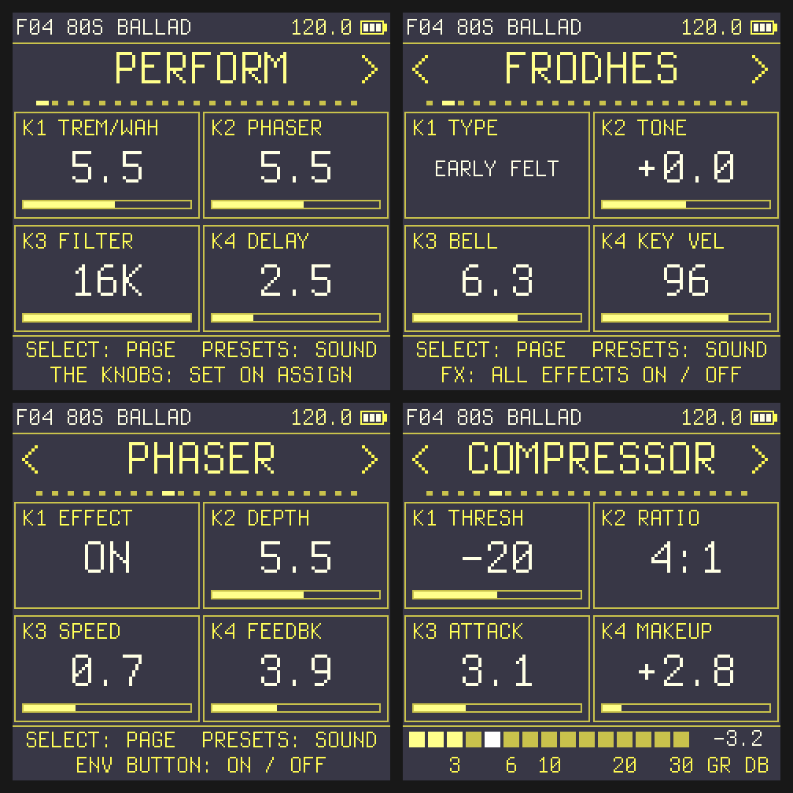

## Contents

1. [Install](#1-install)
2. [The idea: one page, four knobs](#2-the-idea-one-page-four-knobs)
3. [Buttons and knobs](#3-buttons-and-knobs)
4. [The pages](#4-the-pages)
5. [VIBES: the vibraphone](#5-vibes-the-vibraphone) (the motor: [on and off](#the-motor-on-and-off))
6. [Presets](#6-presets)
7. [Effects on and off](#7-effects-on-and-off)
8. [Tempo and sync](#8-tempo-and-sync)
9. [Scales](#9-scales)
10. [Sustain and polyphony](#10-sustain-and-polyphony)
11. [Sound and volume tips](#11-sound-and-volume-tips)
12. [MIDI](#12-midi)
13. [If something goes wrong](#13-if-something-goes-wrong)
14. [Specifications](#14-specifications)

## 1. Install

1. Download `frodhes-0.9.2.fwsc` from the
   [releases page](https://github.com/leonardoMirabal/frodhes/releases/latest).
2. Connect the FM-1 to your computer with USB.
3. Install it from a terminal with the installer in this repository:
   `python3 tools/fm1_install.py frodhes-0.9.2.fwsc` (it needs `pip install mido python-rtmidi`). Once Frodhes is listed
   on [thefirmwarehub.com](https://thefirmwarehub.com), its web installer works too (Chrome or Edge).
4. The FM-1 restarts into Frodhes. If it does not come back by itself, switch it off and on.

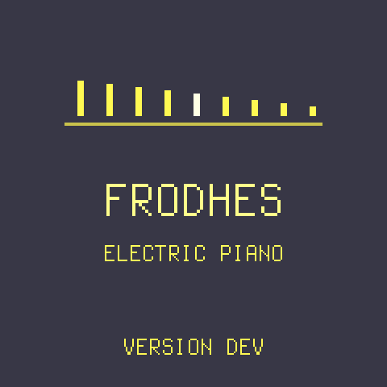

Frodhes starts with its own screen: the name and the version installed. It gives way to the PERFORM page after a moment,
or as soon as you touch a button or a knob.
 

To go back to M-VAVE's own firmware, use the hub's "Official firmware" section with the V15 file from m-vave.com.

## 2. The idea: one page, four knobs

The screen shows **one page at a time**, with **four cards**, one per knob: **K1–K4 always turn the four cards you
see**. The page name is at the top, with a row of marks under it showing where you are. Turn **SELECT** to move
between pages, or press a page's button to jump straight there. The pages, in SELECT order:

PERFORM · FRODHES (main) · VOICE · DECAY · COMPRESSOR · FILTER · DRIVE · TREM/WAH · PHASER · CHORUS · DELAY ·
REVERB · TEMPO · SCALE · CHORD · ARPEGGIO · LFO · SEQUENCER · ASSIGN · SETUP · MIDI

A card that sets an amount has a **gauge** under its number: a thin frame that fills from the left, empty at 0
(DRIVE 0.0 shows an empty frame). Cards for a choice (TYPE, ON / OFF, a note value) have none. The numbers are
rounded to what fits on the card (1.486 s shows 1.5S, +11.8 dB shows +12).

The top line shows the preset, the octave (O+1, O−2...), **SUS** while the sustain is held, **BYP** while the effects
are bypassed, the tempo and, last, the battery. The battery has three segments (the last one left turns the accent colour,
an empty outline means charge it soon); while USB powers the FM-1 it shows a bolt instead. It follows the battery
slowly (over about ten seconds), so it does not flicker. The levels are a first estimate and may be adjusted. The bottom line explains the page's button or shows a live reading; when you change a
preset or switch an effect it briefly shows what happened, in large letters.

## 3. Buttons and knobs

| Control | What it does |
| --- | --- |
| **SELECT** (knob) | Next / previous page |
| **K1 K2 K3 K4** | The four cards on the current page |
| **ALGORITHM** (knob) | The TYPE (the four Rhodes and VIBES), from any page (on SEQUENCER: the step cursor) |
| **PRESETS** (knob) | Browse the sounds F01–F14 and your U01–U16 (loads when you stop turning; on SEQUENCER: bar by bar) |
| **MASTER** (knob) | Volume |
| **HOME** | PERFORM page; press again for the main page (titled FRODHES), and back |
| **EDIT** | CHORD page; press again there to switch chord mode on / off (it comes back with the last chord type) |
| **ENV** | PHASER page; press again there to switch the phaser on / off |
| **LFO** | TREM/WAH page; press again there to switch it on / off |
| **SEQ** | SEQUENCER page; there it switches recording on / off, held 1 s it clears the pattern |
| **SEL** | DELAY page; press again there to switch the delay on / off. On ARPEGGIO: the arpeggiator's HOLD on / off |
| **ARP** | ARPEGGIO page; press again there to switch the arpeggiator on / off |
| **GLO** | TEMPO page; press again for SETUP, again for MIDI, and back to TEMPO |
| **FX** | All effects off / on at once (see [7](#7-effects-on-and-off)) |
| **PLAY** | Tap tempo, on every page (ARPEGGIO too); on SEQUENCER, start / stop the loop |
| **REC** | Sustain pedal |
| **SAVE** | Save the sound to a user preset; hold to undo the last preset load |
| **OCT− / OCT+** | Octave down / up (±2) |

The lights tell you what is on: LFO (tremolo / wah), ENV (phaser) and SEL (delay) light up when their effect is on
(on ARPEGGIO, SEL shows HOLD), ARP while the arpeggiator runs, EDIT while chord mode is on, SEQ while the sequencer
plays (blinking while it records), FX when the effects are
active, REC while the sustain holds (from MIDI CC 64 too), PLAY on the beat when something is synced (and while the
sequencer or the arpeggiator plays), HOME on PERFORM and the main page, GLO on TEMPO, SETUP and MIDI,
OCT− / OCT+ while the octave is shifted, SAVE blinking in save mode, and each key while its note is held or still
rings under the sustain.

## 4. The pages

### PERFORM

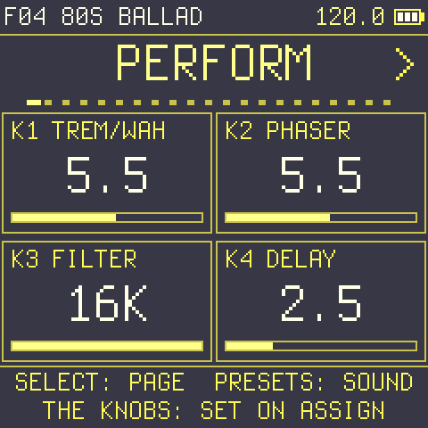

The first page, made for playing: four knobs for the sound while you play. Out of the box they are the dry / wet of
the effects and the filter's cutoff:

| Knob | Card | What it does |
| --- | --- | --- |
| K1 | **TREM/WAH** | How much tremolo (or auto-pan / wah, as chosen on its page) |
| K2 | **PHASER** | How much phaser |
| K3 | **FILTER** | The filter's cutoff (turning it down with the filter off switches it on as LP18) |
| K4 | **DELAY** | How much delay |

Turning an effect up from here **switches it on**, so you can go from dry to wet with one knob; its light comes on.
Turning it back to 0 makes it dry again (the effect stays switched on; its button switches it off). **FX** still bypasses all of them at once.

### FRODHES (the main page)

The page after PERFORM (press **HOME** twice) carries the instrument's name as its title and holds the essentials.

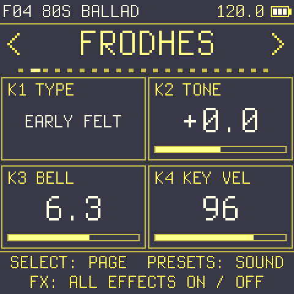

| Knob | Card | What it does |
| --- | --- | --- |
| K1 | **TYPE** | The instrument: **STAGE 77** (the classic Mark I), **SUITCASE** (with its Peterson amp and 4×12 speakers), **EARLY FELT** (1970 felt hammers: rounder, darker), **BELL DYNO** (Dyno-My-Piano voicing: glassy, bell-like), or **VIBES**, the vibraphone (see [VIBES](#5-vibes-the-vibraphone)). Applies to the next notes. |
| K2 | **TONE** | Where the tine sits against the pickup: lower is rounder and warmer, higher is more bell and midrange (the same as VOICE's TONE). On VIBES: **MALLET** |
| K3 | **BELL** | The bright metallic overtone at the start of each note (the same as VOICE's BELL). On VIBES: **MOTOR** on / off |
| K4 | **KEY VEL** | How hard the FM-1's own keys strike. The keys are not velocity-sensitive, so this decides the touch: around 60–80 soft and round, 96 medium, 108–127 hard with bark. MIDI notes keep their own velocity. |

### VOICE

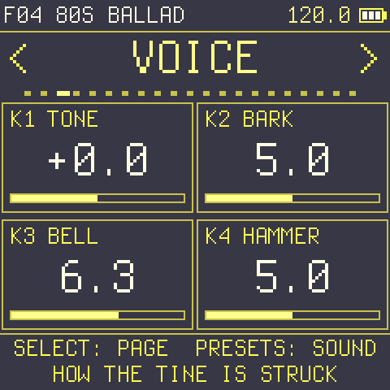

| Knob | Card | What it does |
| --- | --- | --- |
| K1 | **TONE** | Where the tine sits against the pickup: lower is rounder and warmer, higher is more bell and midrange |
| K2 | **BARK** | How close the pickup is: more bark (the growl of hard notes) and more output |
| K3 | **BELL** | The bright metallic overtone at the start of each note |
| K4 | **HAMMER** | Hammer hardness: softer is darker, harder is brighter |

On **VIBES** these cards are the vibraphone's: see [VIBES](#5-vibes-the-vibraphone).
### DECAY

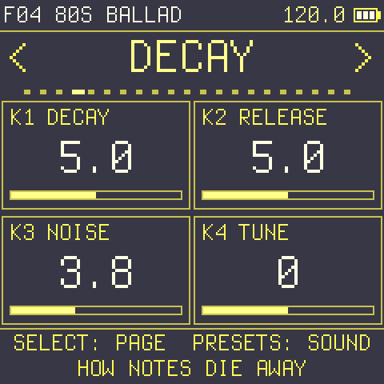

| Knob | Card | What it does |
| --- | --- | --- |
| K1 | **DECAY** | How long a held note rings |
| K2 | **RELEASE** | How fast the damper stops a note when you let go |
| K3 | **NOISE** | The damper's soft knock and the felt's sound when you let go |
| K4 | **TUNE** | Fine tuning, ±50 cents |

On **VIBES** these cards are the vibraphone's: see [VIBES](#5-vibes-the-vibraphone).
### COMPRESSOR

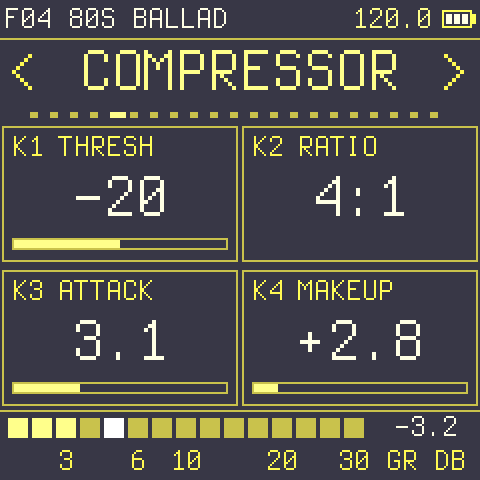

| Knob | Card | What it does |
| --- | --- | --- |
| K1 | **THRESH** | **OFF** at 0: turn it up to switch the compressor on; then where it starts, down to −40 dB. Lower = more compression |
| K2 | **RATIO** | How strongly it compresses: 1.5:1 to 20:1 |
| K3 | **ATTACK** | How fast it grabs a note: low (0.1 ms) catches the hammer's attack, high (50 ms) lets it through |
| K4 | **MAKEUP** | Gives back the volume the compression takes: 0 to +24 dB |

**THRESH** is its on / off: turn it up from OFF and the compressor comes on with MAKEUP at +2.8 dB, which keeps the
volume about the same (back to OFF switches it off). The bottom of the page is a gain-reduction meter, as on a hardware compressor: its segments light from 1 dB
to 30 dB of reduction (scale 3, 6, 10, 20, 30), a bright segment holds the peak for a second, and the number on the
right is the reduction now in dB. The compressor
comes first in the chain, right after the piano.

### FILTER

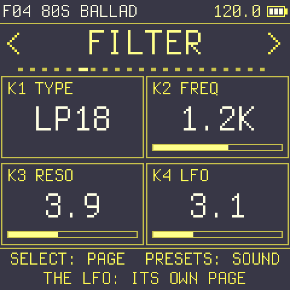

A resonant filter right after the compressor (before drive and the other effects), moved by its own LFO.

| Knob | Card | What it does |
| --- | --- | --- |
| K1 | **TYPE** | **OFF**; **LP12** / **LP18** low-pass (12 or 18 dB per octave: the higher, the steeper); **HP12** / **HP18** high-pass; **BP** band-pass; **NOTCH**. The default is **LP18** fully open (16 kHz), so the filter is ready: turn FREQ (or PERFORM's K3) down and it closes |
| K2 | **FREQ** | The cutoff, 30 Hz to 16 kHz |
| K3 | **RESO** | Resonance: from smooth to a whistling peak at the cutoff |
| K4 | **LFO** | How far the LFO moves the cutoff (up to ±4 octaves); the LFO itself is set on the LFO page |

On PERFORM, K3 is the filter's cutoff by default. Fully open it leaves the piano as it is up to about 8 kHz (−0.4 dB
there, −1.4 dB at 12 kHz). The factory presets use the default; your own presets keep what you saved, and so does the
sound the FM-1 was left on. Over MIDI: CC 70 TYPE, 74 cutoff, 71 resonance, 72 LFO amount.

### DRIVE

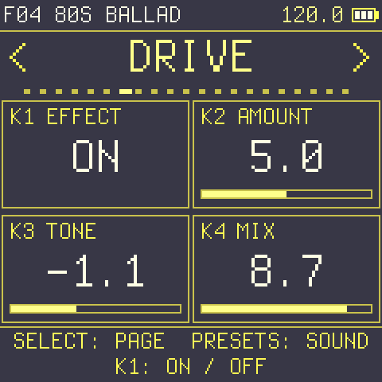

The amp drive, right after the filter. AMOUNT is the same as DRIVE on the main page.

| Knob | Card | What it does |
| --- | --- | --- |
| K1 | **EFFECT** | **ON** / **OFF** (switching it on with AMOUNT at 0 gives it a starting amount) |
| K2 | **AMOUNT** | From clean to growl: an overdrive. Low settings warm the sound a little, above the middle a single note starts to break up, the top is a full, compressed overdrive (not a fuzz). It changes the tone, not the volume (big chords come out a little lower at the top, as an amp squashes them); at 0 there is no drive |
| K3 | **TONE** | After the drive: darker (down to the highs gone) or brighter (up to +6 dB of treble); the middle (+0.0) leaves it as it is |
| K4 | **MIX** | Dry / driven: 10.0 is all drive (as before), lower blends the clean piano back in, 0 is clean |

When the drive is off, the DRIVE card on the main page (and on PERFORM) shows **OFF**; turning it up there switches
the drive on. Moving any of the knobs glides, so you can turn them while you play. Over MIDI: CC 81 AMOUNT, 82 TONE,
83 MIX, 84 on (≥ 64) / off.

### TREM/WAH

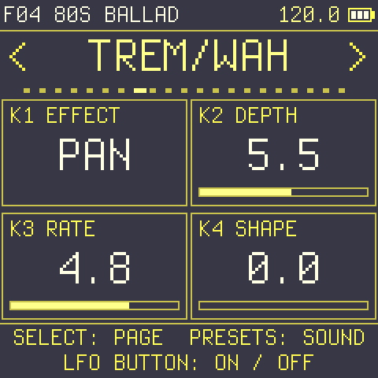

| Knob | Card | What it does |
| --- | --- | --- |
| K1 | **EFFECT** | **OFF**, **PAN** (the Suitcase stereo vibrato), **TREM** (volume tremolo), **WAH** (touch wah: harder playing opens it; it keeps the sound's level, so a closed wah on a high chord is not quieter and a low one not louder) |
| K2 | **DEPTH** | How deep |
| K3 | **RATE** | How fast; on WAH, the resonance. When synced it shows a note value |
| K4 | **SHAPE** | From a smooth sine to a square, choppy pulse |

On **VIBES** the vibraphone's motor is not here but on its own page, MOTOR (see [the motor: on and off](#the-motor-on-and-off)); TREM/WAH can run on top of it.
### PHASER

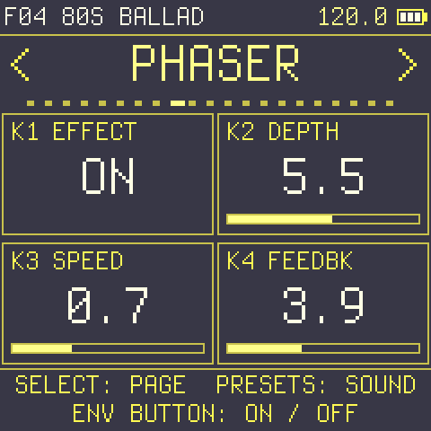

| Knob | Card | What it does |
| --- | --- | --- |
| K1 | **EFFECT** | Off / on |
| K2 | **DEPTH** | How far it sweeps |
| K3 | **SPEED** | How fast: 0.25–6 Hz (a note value when synced) |
| K4 | **FEEDBK** | Resonance: more pronounced, vocal sweeps (it never builds up on the bass) |

### CHORUS

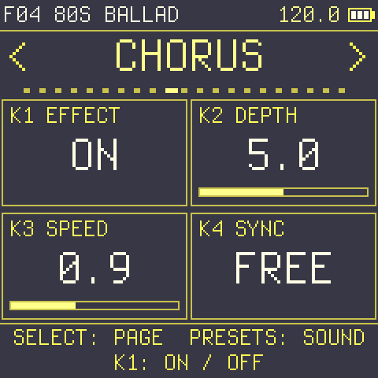

| Knob | Card | What it does |
| --- | --- | --- |
| K1 | **EFFECT** | Off / on |
| K2 | **DEPTH** | Amount and width |
| K3 | **SPEED** | How fast: 0.25–6 Hz (a note value when synced) |
| K4 | **SYNC** | Free, or locked to the tempo as a note value |

Phaser and chorus are two separate effects and can run together (the phaser feeds the chorus). Switched on at the
panel's depth the phaser keeps the level (its notches sweep through the sound; the bass is no longer lifted) and keeps
the sound close to the middle (its two sides 30° apart). The chorus makes the sound wider in stereo, which on headphones
sounds bigger; its level is set so that it does not also sound louder.

### DELAY

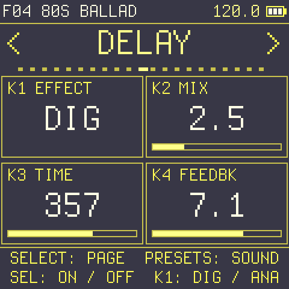

| Knob | Card | What it does |
| --- | --- | --- |
| K1 | **EFFECT** | **OFF**, **DIG** (clean digital), **ANA** (tape-like: darker, with a little wow and flutter) |
| K2 | **MIX** | How loud the echoes are |
| K3 | **TIME** | Echo time, free in milliseconds; when DLY SYNC is set on TEMPO it shows and steps note values |
| K4 | **FEEDBK** | How many echoes |

### REVERB

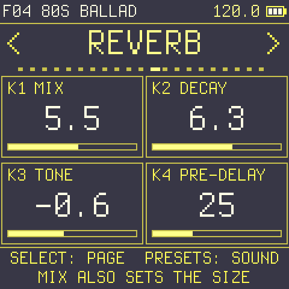

The hall reverb, the last effect. MIX is the same as REVERB on the main page.

| Knob | Card | What it does |
| --- | --- | --- |
| K1 | **MIX** | How much reverb; more also makes the hall bigger (0 = none, the tail rings out) |
| K2 | **DECAY** | How long the hall rings: 5.0 as before, 0 about half as long, 10.0 about twice |
| K3 | **TONE** | The tail's treble: darker (more damping) or brighter (less); +0.0 as before |
| K4 | **PRE-DELAY** | A gap before the reverb starts, 0–80 ms, so the notes stay clear in front of the hall |

Over MIDI: CC 91 MIX, 92 DECAY, 93 TONE, 94 PRE-DELAY. All four glide when moved.

### TEMPO

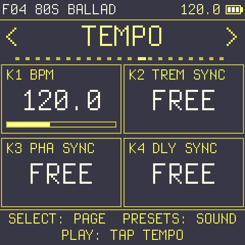

| Knob | Card | What it does |
| --- | --- | --- |
| K1 | **BPM** | Tempo, 40–240. **PLAY** taps it (from the third tap) |
| K2 | **TREM SYNC** | The tremolo locked to the tempo (FREE = its own RATE) |
| K3 | **PHA SYNC** | The phaser locked to the tempo |
| K4 | **DLY SYNC** | The delay locked to the tempo |

### SCALE

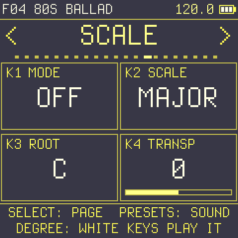

| Knob | Card | What it does |
| --- | --- | --- |
| K1 | **MODE** | **OFF**; **SNAP** (every key plays: an out-of-scale note plays the nearest note of the scale); **DEGREE** (the white keys walk the scale, the black keys are silent) |
| K2 | **SCALE** | Major, minor, dorian, mixolydian, lydian, phrygian, harmonic and melodic minor, pentatonic, minor pentatonic, blues |
| K3 | **ROOT** | The scale's key |
| K4 | **TRANSP** | Transpose ±24 semitones |

### CHORD

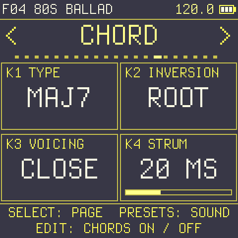

Chord mode: **one key plays a whole chord**. Press **EDIT** to come here, and **EDIT** again to switch chord mode
on / off (it comes back with the last chord type, MAJ the first time; the EDIT light shows it).

| Knob | Card | What it does |
| --- | --- | --- |
| K1 | **TYPE** | **OFF**; **DIATONIC** / **DIA 7TH**: the chord (triad / seventh) that belongs to the key and scale set on the SCALE page, so in C major D plays Dm, G plays G, B plays Bdim; or a fixed shape on every key: **MAJ**, **MIN**, **7**, **MAJ7**, **MIN7**, **SUS2**, **SUS4**, **ADD9**, **DIM**, **AUG**, **6**, **MIN6** |
| K2 | **INVERSION** | **ROOT**, **1ST**, **2ND**, **3RD** (the lowest notes moved up an octave; on a three-note chord 3RD is the root position an octave up) |
| K3 | **VOICING** | **CLOSE**; **OPEN** (the second note up an octave, wider); **+BASS** (the root added an octave below) |
| K4 | **STRUM** | 0 to 60 ms between the notes, low to high, like a strum |

It works with the scales (with SNAP the key first moves onto the scale), with notes from USB-MIDI, with the
arpeggiator (which then arpeggiates the chord) and with the sequencer (which records the chord's notes).

### ARPEGGIO

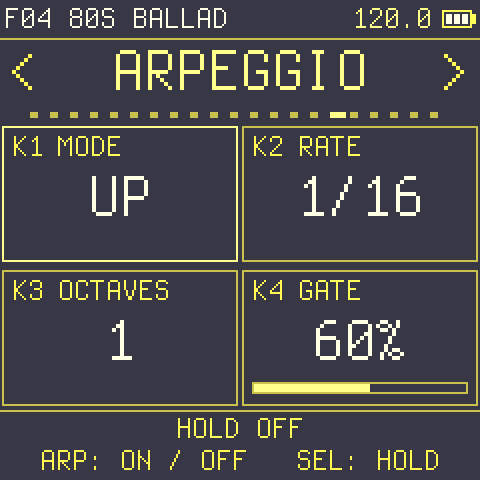

Hold a chord and the arpeggiator plays its notes one at a time, in time with the tempo (tap tempo and MIDI clock
too). Press **ARP** to come here, and **ARP** again to switch it on / off (the ARP light shows it).

| Knob | Card | What it does |
| --- | --- | --- |
| K1 | **MODE** | **OFF**, **UP**, **DOWN**, **UP-DN** (up and back down), **ORDER** (the order you played the notes), **RANDOM** |
| K2 | **RATE** | The note value: 1/4 (one note per beat), 1/8, 1/8T, 1/16, 1/16T, 1/32 |
| K3 | **OCTAVES** | 1 to 4: the pattern repeated octaves up |
| K4 | **GATE** | How long each note sounds: 10 % short and plucked, 100 % legato |

Up to 16 notes; every note of the arpeggio plays at the velocity of the first note you held.

It plays while you hold the keys. **SEL** on this page switches **HOLD** (the latch) on / off: the SEL light and the
bottom line show it (PLAY taps the tempo here too, as on every page). With HOLD on, play a chord and let go, and the arpeggio keeps going with those notes; the next
chord you play (after letting go of every key) replaces them, and keys you add while others are still held join the
pattern. Switching HOLD off stops the notes you are no longer holding. The sustain (REC) stays the piano's sustain
pedal. It works with the scales (the notes are already on the scale) and with notes from USB-MIDI. The
settings belong to the FM-1, not to a preset; ARP RATE and ARP GATE can also be put on a PERFORM knob.

### LFO

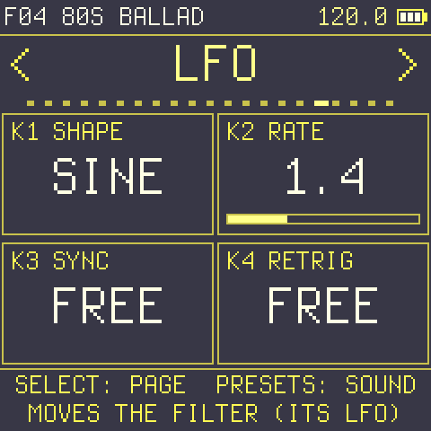

The filter's LFO (it moves FREQ by the FILTER page's LFO amount).

| Knob | Card | What it does |
| --- | --- | --- |
| K1 | **SHAPE** | **SINE**, **TRI**, **SAW** (rising), **RAMP** (falling), **SQR** (square), **S&H** (a random step each cycle) |
| K2 | **RATE** | Free, 0.5 to 12 Hz; when SYNC is set it shows and steps note values |
| K3 | **SYNC** | **FREE**, or locked to the tempo: 1/32 to 4 bars |
| K4 | **RETRIG** | **FREE** (it runs on its own) or **KEY** (it starts from the beginning with every note) |

### SEQUENCER

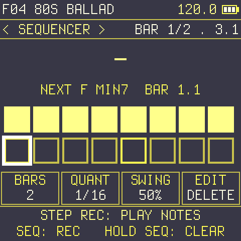

A **pattern recorder**: play notes or chords (chord mode too) and they loop, quantized, while you keep adding and
editing. The screen is made to be read at a glance: the top line shows where the loop is (**BAR 2/4 . 3** = bar 2
of 4, beat 3); the chord or note playing **now** is in big letters (D MIN7, C4...), with what comes **next** and
where under it; and the bar playing is shown as **16 big cells** (16ths, in two rows of 8): a filled cell is where
notes start, a cell with a band is where they are still held, the white one is where the loop is.

| Knob | Card | What it does |
| --- | --- | --- |
| K1 | **BARS** | The loop's length, 1 to 16 bars (notes past the end are kept and come back if you make it longer) |
| K2 | **QUANT** | **OFF**, **1/4**, **1/8**, **1/16**, **1/8T**, **1/16T**: the grid the notes snap to as they play. It never changes what you recorded, so you can switch it at any time and hear the pattern tighten or loosen |
| K3 | **SWING** | 50 % (straight) to 75 %: pushes the off-beat 1/8s or 1/16s |
| K4 | **EDIT** | Turn **left: UNDO** the last pass you recorded (again: the one before), or, with the cursor on a step, **DELETE** that step's notes. Turn **right: ERASE** on / off: while it plays, hold keys and their notes are removed as the loop passes them |

- **Look through it, step by step:** on this page **ALGORITHM** moves a cursor (a white frame) one 16th at a time,
  across the bars, and **PRESETS** jumps a whole bar. The top line shows where (**BAR 2/4 . 3.2** = bar 2, beat 3,
  second 16th) and the big letters show what starts on that step ("-": nothing). Turn **EDIT left** there to
  **delete** that step's notes. While the loop plays, the view goes back to following it 4 s after you stop turning.
  (On every other page ALGORITHM is the TYPE and PRESETS the presets, as always.)
- **PLAY** starts and stops the loop. Stopping takes everything back to the start: the loop and the cursor go to
  **bar 1, step 1** (nothing is erased).
- **SEQ** switches recording on / off (the SEQ light blinks).
  - **Playing (live):** every pass adds what you play on top (overdub), quantized; the loop never stops. Arm REC, then
    press PLAY to start.
  - **Stopped (step by step):** what you play goes on the **cursor's step**, as long as the QUANT grid (1/16: one
    step, 1/8: two, 1/4: four); let go and the cursor moves on by that much. Keep the keys held and turn
    **ALGORITHM** to make that note or chord longer (LENGTH n STEPS); turn ALGORITHM without playing to leave a rest.
    UNDO takes back the last step you entered.
- **Hold SEQ** for a second: **clear** the whole pattern.
- **Limits:** 4/4, up to 448 notes per pattern (96 steps per beat inside), 32 sounding at once. A new FM-1 starts
  with 4 bars, QUANT OFF and SWING 50 %; SWING acts on the 1/8 and 1/16 grids.

Press **SEQ** to come here, from any page. The pattern goes through the
arpeggiator when it runs, plays the effects like your hands do, and is kept on the FM-1 when you switch off (it is
stored when the loop is stopped).

### ASSIGN

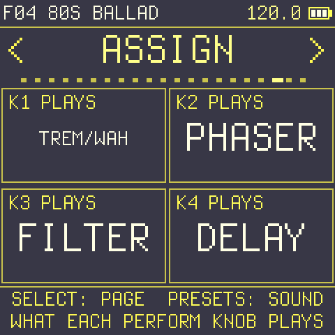

Choose what each PERFORM knob plays: K1 here sets what K1 on PERFORM does, and so on. ASSIGN sits near the end of
the pages, just before SETUP (the hint on PERFORM says so). Each knob can play any of:
TREM/WAH, PHASER, CHORUS, DELAY, REVERB, DRIVE, COMP THR, COMP MKUP, TREM RATE, TREM SHAPE, PHA SPEED, PHA FEEDBK,
CHO SPEED, DLY TIME, DLY FEEDBK, DLY TONE, TONE, BARK, BELL, HAMMER, DECAY, RELEASE, NOISE, KEY VEL, LEVEL, ARP RATE,
ARP GATE, FILTER, FILT RESO, FILT LFO and LFO RATE. The
choice is kept when you switch off (it belongs to the FM-1, not to a preset).

### SETUP

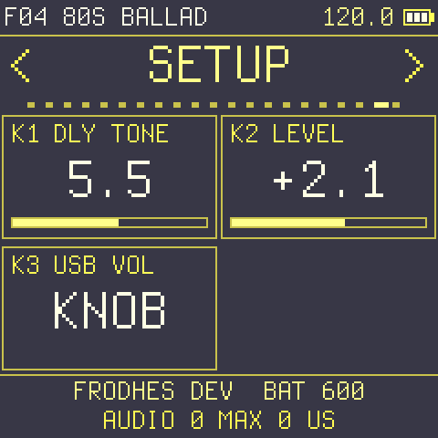

| Knob | Card | What it does |
| --- | --- | --- |
| K1 | **DLY TONE** | The delay's echo colour |
| K2 | **LEVEL** | This preset's volume, −12 to +11.8 dB, saved with the preset |
| K3 | **USB VOL** | **KNOB**: the USB audio follows the MASTER knob, as the headphones do. **FIXED**: the USB audio always comes at full level, whatever the knob (and headphones plugged in) do; the headphone jack still follows MASTER |

The bottom line shows the name and the version installed, the battery's reading (BAT, the raw value the battery
segments are worked out from), and the audio engine's time per block (it must stay under 5800 µs; eight notes struck at once with every effect on reach about 3900).

### MIDI

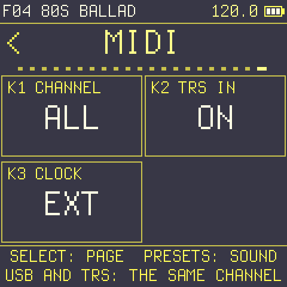

| Knob | Card | What it does |
| --- | --- | --- |
| K1 | **CHANNEL** | **ALL** (the default: every channel is played) or **1–16**: only that channel is heard (notes, CCs and program changes; clock, Start and Stop always are), from USB-MIDI and from the TRS jack alike, and the FM-1 sends its notes on it (on ALL it sends on 1) |
| K2 | **TRS IN** | **ON** / **OFF**: MIDI from the 3.5 mm TRS MIDI input (for a DAWless setup: a keyboard, a sequencer, a drum machine's clock) |
| K3 | **CLOCK** | **INT**: its own tempo. **EXT** (the default): follows MIDI clock from USB or the TRS jack when it comes, and a MIDI **Start** / **Continue** starts the sequencer, **Stop** stops it |

Press **GLO** three times to come here (TEMPO, SETUP, MIDI). Everything MIDI does, it does the same from USB and from
the TRS jack: notes, every CC in the table below, program changes, clock, start and stop.

## 5. VIBES: the vibraphone

Turn **ALGORITHM** (or the TYPE card) to **VIBES** and the FM-1 plays a vibraphone: aluminium bars struck with
mallets, each with its tuned tube underneath, and the motor that gives the vibraphone its pulsing shimmer. Like the
Rhodes it is computed, not sampled: the bar's own modes (the fundamental and its tuned overtones, about 4 and 10
times higher), the tube that takes a moment to build up under the bar, and the motor's discs. Switching between a
Rhodes type and VIBES fades out what is still ringing.

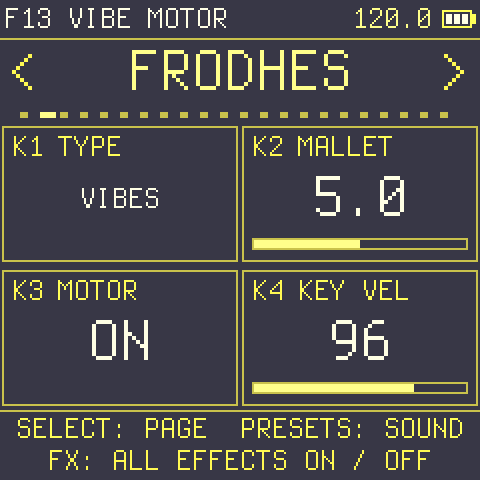

The main page's middle cards belong to the engine: on VIBES they are **MALLET** (the same as VOICE's MALLET) and
**MOTOR** (on / off, the same as the MOTOR page's first card); on a Rhodes type they are **TONE** and **BELL** (DRIVE and REVERB have their own pages).

VIBES plays about **2.5 dB louder** than the Rhodes types: a struck bar is peakier than a Rhodes note, so at the same
loudness it sounded weaker and came out closer to the headphone jack's hiss. The limiter still keeps big chords from
clipping.

On VIBES the VOICE and DECAY cards change their names and what they do, and one page joins them: **MOTOR**.
The VOICE cards act on the next strike (a ringing bar keeps the strike that started it, as a real one does).

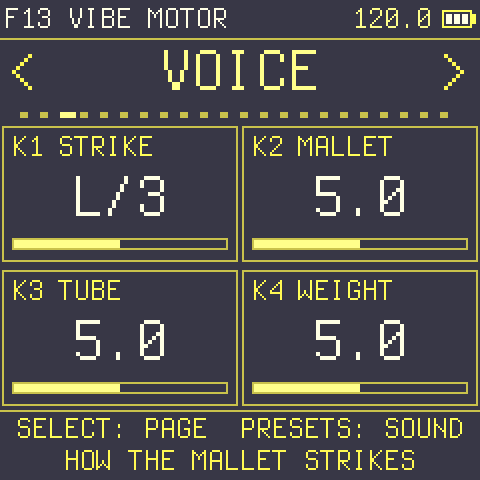

| Knob | Card | What it does on VIBES |
| --- | --- | --- |
| K1 | **STRIKE** | Where the mallet hits the bar: **CENTRE** (left end), a fuller, rounder fundamental with the 10th partial and no 4th; **L/3** (the middle of the knob, the usual spot), the 4th partial back; toward the **EDGE** (right), off the centre line, the bar's twisting modes ring in: metallic and slightly out of tune |
| K2 | **MALLET** | How hard the mallet is: **SOFT** (0) a dark, round, almost pure fundamental with a soft onset, even when you play hard; **YARN** (42) round and warm, the overtones held back; the middle (64, the default) the usual vibes sound; **CORD** (85) clearer, the 10th partial rings; **RUBBER** (127) hard and bright, bell-like, with a click. The card shows the mallet's name, or a number between two of them. The low bars show the soft mallets apart best, the middle and high bars the hard ones |
| K3 | **TUBE** | How much the tube rings with the bar: 0 is a bare bar (about 6-7 dB quieter than the middle, thin, rings longer, no bloom); up is a fuller, warmer, louder note that blooms just after the strike and dies sooner, as on a real vibraphone (the right end about 3-4 dB over the middle) |
| K4 | **WEIGHT** | The mallet's weight: light is brighter, quicker and quieter; heavy is darker, with more body (about 6 dB louder at the top than at the bottom). How hard you play (KEY VEL, MIDI velocity) stays the strike's speed: a harder strike is louder and brighter (the overtones come up), a soft one round |

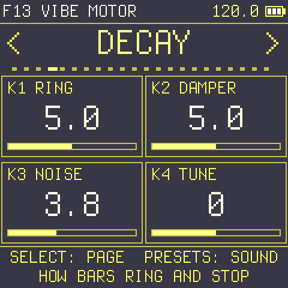

| Knob | Card | What it does on VIBES |
| --- | --- | --- |
| K1 | **RING** | How long a struck bar rings: from a quarter to about four times the normal time |
| K2 | **DAMPER** | How firmly the damper stops the notes when you let go: soft lets them fade, firm stops them short |
| K3 | **NOISE** | The mallet's contact and the damper's touch |
| K4 | **TUNE** | Fine tuning, ±50 cents (many vibraphones are tuned to A = 442 Hz: +8) |

**The pedal** works like the Rhodes' sustain: **REC** (hold, or tap to latch) or a sustain pedal over MIDI (CC 64,
half-pedal too). Without it the damper stops each note when you let go.

### The motor: on and off

The motor (the vibrato's pulse) is part of the vibraphone, not an effect: it has its own page, **MOTOR**, right
after DECAY in the SELECT order. The page is there only while the TYPE is VIBES (on the Rhodes types SELECT goes from
DECAY straight to COMPRESSOR).

- **On by itself:** turning the TYPE to VIBES (ALGORITHM, the TYPE card or CC 79) starts the motor at its default:
  DEPTH 8.7, 3.5 Hz, a clear, regular pulse.
- **Off and on:** on the MOTOR page, **K1** turns it **OFF** or **ON**. Switched off there, it stays off: changing the
  TYPE to a Rhodes and back to VIBES does not start it again (and the choice is saved), until K1 turns it on.
- **Presets keep theirs:** loading a preset is not a TYPE change: **F13 VIBE MOTOR** has the motor on, **F14 VIBES
  DRY** has it off, and a user preset saved with the motor off stays off.
- **The Rhodes types** have no motor: going back to one leaves no tremolo running (TREM/WAH stays as it was).
- **The level** stays the same with the motor on or off (the discs close the tubes part of each turn; the motor
  makes up for what they take).
- **TREM/WAH** (the LFO button) is the same effect on VIBES as on the Rhodes and can run on top of the motor.
- **Over MIDI:** CC 47 ON (≥ 64), 48 DEPTH, 49 SPEED, 50 SHAPE, 51 SYNC.

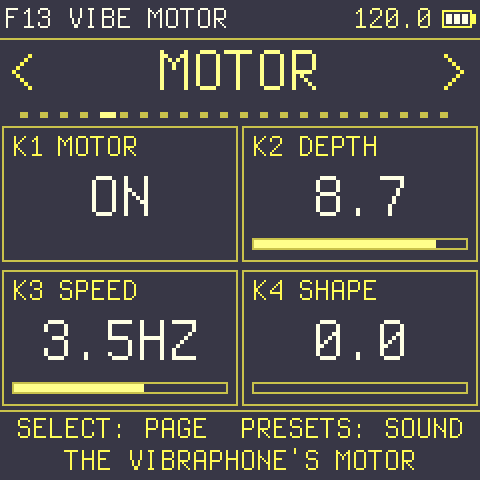

| Knob | Card | What it does |
| --- | --- | --- |
| K1 | **MOTOR** | **ON** / **OFF**; it fades in and out over about 50 ms, so switching never clicks |
| K2 | **DEPTH** | How far the discs close the tubes: a gentle pulse to a deep throb (the default 8.7 gives about 6–9 dB from F3 to F6) |
| K3 | **SPEED** | The motor speed, 0.5–10 Hz (about 3.5 Hz is classic). With a SYNC set over MIDI (CC 51) it shows the note value and follows the tempo |
| K4 | **SHAPE** | How sharply the discs open: soft is a smooth pulse, sharp a shorter, more pointed one |

As on a real vibraphone the motor works on the tubes, so it pulses the ringing note and leaves the high overtones
alone. Its pulse is a little shallower in the lowest octave, where more of the sound comes from the bar itself.

### Range, presets, polyphony

**The range.** A concert vibraphone has three octaves, **F3 to F6**; that is where VIBES is measured against the real
instrument. Every other MIDI note plays too, extended from the same physics. The FM-1's keys (F3–G5) sit in the
vibraphone's range.

**Presets:** **F13 VIBE MOTOR** (the motor at 3.5 Hz, a little reverb) and **F14 VIBES DRY** (motor off, close).
**Polyphony:** 8 notes, as the Rhodes.

## 6. Presets

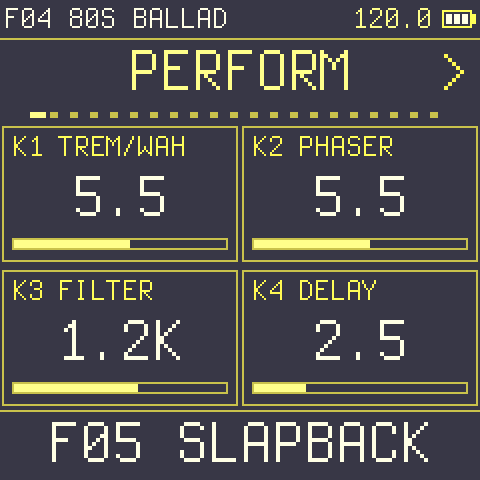

Turn **PRESETS** to browse: **F01–F14** are the factory sounds (F13 and F14 are VIBES), **U01–U16** your own. A preset loads when you stop
turning (after 0.4 s). If you did not mean to, **hold SAVE** (0.7 s) to go back to the sound you had before the
last load (the top line names it again); hold it again to return (redo). The first time Frodhes
starts (or if its settings are ever lost), it plays **F01 STAGE 77**.

| | | | |
| --- | --- | --- | --- |
| F01 STAGE 77 | F02 70S PHASER | F03 SUITCASE | F04 80S BALLAD |
| F05 SLAPBACK | F06 BRIGHT CHO | F07 FUNK WAH | F08 BARK |
| F09 TAPE ECHO | F10 DREAM | F11 RADIO | F12 AM TREMOLO |
| F13 VIBE MOTOR | F14 VIBES DRY | | |

The Rhodes presets F01–F12 are level-matched: each one's LEVEL (SETUP) brings it to about the loudness of F01, so
browsing does not jump in volume (VIBES, F13–F14, sits 2.5 dB above, as the type does).

**Saving:** press **SAVE**. The bottom line asks where; turn **PRESETS** or **K1** to pick U01–U16; press **SAVE**
again to store it, or **HOME** (or **OCT−**) to cancel. The name is made from the type and the effects that are on
("SUIT TRM PHA").

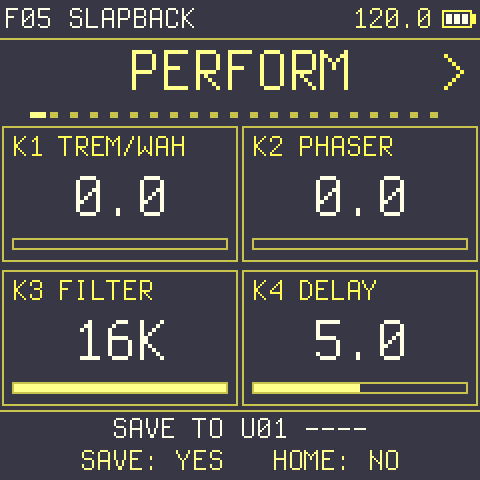

The save waits for silence: the bottom line says **SAVING...** until the sound has died away, then **SAVED**. A user
preset can be overwritten but not deleted, and browsing skips the empty ones. There is no factory reset: F01–F14 are
always there to start again from.

**What is kept, and when:**

| A preset (U01–U16) | The FM-1 itself (settings) | The pattern |
| --- | --- | --- |
| The sound: TYPE, every VOICE / DECAY card, every effect and its sync, the filter and LFO, LEVEL | KEY VEL, TUNE, TRANSP, the octave, tempo and CLOCK, scale, chord mode, arpeggiator, sequencer settings, PERFORM assignments, the MIDI page, USB VOL, and the last sound | The sequencer's notes |
| When you press SAVE (once silent) | About 2 s after your last change, once the sound has died away | 1.5 s after a change, while stopped and silent |

So after a change, let the sound die away for a couple of seconds before you switch off.

## 7. Effects on and off

Each effect has its own on / off: its page button pressed twice (LFO: tremolo / wah, ENV: phaser, SEL: delay), its
K1 card on its page (chorus: EFFECT; compressor: THRESH), or turning it up on PERFORM. Switching an effect on whose depth is 0 gives it a useful starting depth, so you always hear it.

**FX** switches **all** effects off at once and back on (the compressor, filter, drive and reverb included, with a
short crossfade), without changing any setting: compare the dry piano with
your sound. The header shows **BYP** while they are off. It is not saved, so the FM-1 always starts with the effects
on.

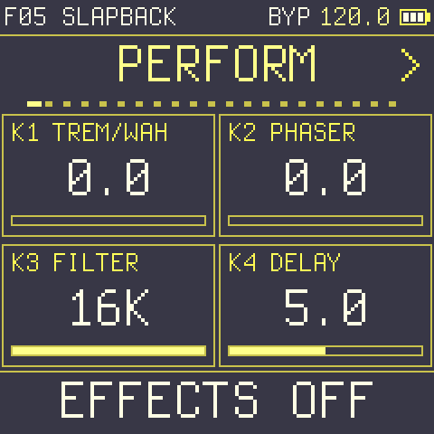

The order of the chain: **COMP → FILTER → DRIVE → TREM/WAH → PHASER → CHORUS → DELAY → REVERB → limiter.** The limiter at the
end keeps even big chords of eight notes from ever clipping.

## 8. Tempo and sync

Tap **PLAY** three times or more in time to set the tempo, or set **BPM** on the TEMPO page. With **CLOCK** on EXT
(the default; MIDI page), Frodhes follows MIDI clock from USB or the TRS jack, and an external Start / Stop starts and
stops the sequencer (send clock from one of them at a time: two clocks at once would add up). The tremolo, phaser and
delay can each lock to the tempo on the TEMPO page (TREM SYNC, PHA SYNC, DLY SYNC), and the filter's LFO on the LFO
page. When one is synced, its RATE / SPEED / TIME card shows a note
value and turning it steps through them: 1/32, 16T, 1/16, 8T, 16D, 1/8, 4T, 8D, 1/4, 4D, 1/2, 1/1, 2 BAR (and 4 BAR
for the chorus, phaser and the LFO). A synced echo longer than the delay's 1.48 s plays at half (or a quarter) of
that time. PLAY blinks on the beat while anything is synced.

MIDI clock in is 24 pulses per beat, from 40 to 240 BPM. **Start** and **Continue** both start the pattern from bar
1. Frodhes does not send MIDI clock.
The tempo also drives the arpeggiator and the sequencer.

## 9. Scales

On the SCALE page, **SNAP** lets every key play but moves out-of-scale notes onto the scale, and **DEGREE** turns the
white keys into the scale's steps (C plays the root) so you can play any scale with white keys only.
While a scale is on, the keys that play its root glow dimly (in DEGREE: the C keys), so you can always find the
keynote.

## 10. Sustain and polyphony

**REC** is the sustain pedal. **Hold** it like a pedal, or **tap** it to latch the sustain on, and tap again to
release. The header shows **SUS** while it holds. Over MIDI, CC 64 works with half-pedalling.

**Polyphony: 8 voices.** Up to 8 notes sound at the same time, counting notes still ringing under the sustain and
the notes that chord mode, the arpeggiator and the sequencer play. Striking a note that is still sounding reuses its
voice, so repeated notes do not use up voices. A 9th note takes over the quietest released note first, or else the
oldest held one, with a short fade (1.5 ms) so there is no click. The audio also has a safety guard: if it ever ran
late, the quietest released note would be faded out rather than letting the sound break up. In testing the worst
case (8 low notes at full velocity with the pedal and every effect on) uses 3.9 ms of the 5.8 ms available per audio
block, and the guard never acts.

## 11. Sound and volume tips

- **KEY VEL** on the main page is your touch. 96–108 is a good start; the bark comes in above about 100.
- **MASTER is digital.** For the least hiss on the headphone jack, keep MASTER high and turn your speakers or
  headphones down instead. Between notes the output is exact silence, so the jack is silent too.
- **TYPE** changes the whole instrument: try BELL DYNO for glassy ballads and SUITCASE for the classic vibrato with
  the tremolo on PAN.
- Every effect is set to keep about the same volume when you switch it on; the compressor's MAKEUP and each preset's
  LEVEL (SETUP) let you fine-tune it.

## 12. MIDI

Frodhes is a class-compliant USB-MIDI device and also listens to the FM-1's **TRS MIDI input** (3.5 mm; MIDI page:
TRS IN, CHANNEL). Notes play with their velocity (and go through the arpeggiator when it runs); the FM-1's keys
also send their notes to the computer.

**MIDI out is USB only:** the FM-1's keys, chord mode, the arpeggiator and the sequencer send their notes on CHANNEL
(channel 1 when ALL). Notes that come in over MIDI are not sent back, but what the arpeggiator or the sequencer
makes from them is, so switch MIDI thru off in your computer's software. No clock, CCs or program changes are sent.
The TRS jack is MIDI in only. **Program Change** 0–13 loads F01–F14, 16–31 loads U01–U16.

| CC | Parameter | CC | Parameter |
| --- | --- | --- | --- |
| 64 | Sustain (half-pedal) | 80 | TYPE (0–31 STAGE, 32–63 SUITCASE, 64–95 FELT, 96–127 DYNO) |
| 47 / 48 | VIBES MOTOR on (≥ 64) / DEPTH | 49 / 50 / 51 | VIBES MOTOR SPEED / SHAPE / SYNC |
| 79 | TYPE VIBES (any value) | 9 | Developer: VIBES mode cap (0 = automatic, 1–49 = 0–48 upper modes, ≥ 50 = none; not saved) |
| 10 | Developer: reset (≥ 64): every LFO, the delay / reverb lines and the noise to their start state (for comparing recordings) | | |
| 81 | DRIVE (AMOUNT) | 91 | REVERB (MIX) |
| 82 / 83 / 84 | DRIVE TONE / MIX / on (≥ 64) | 92 / 93 / 94 | REVERB DECAY / TONE / PRE-DELAY (0–80 ms) |
| 17 | TREM/WAH: 0–42 off, 43–85 trem/pan, 86–127 wah | 18 / 19 | TREM DEPTH / RATE |
| 20 / 21 / 22 | TREM SYNC / MODE (0–63 pan, 64–127 am) / SHAPE | 85 | Chorus / phaser (reface): off / chorus / phaser |
| 86 / 87 | CHORUS DEPTH / SPEED (the phaser's, when only the phaser is on) | 23 | CHORUS SYNC |
| 12 / 13 / 14 | PHASER on / DEPTH / SPEED | 15 / 16 | PHASER SYNC / FEEDBACK |
| 88 / 89 / 90 | DELAY type / MIX / TIME | 25 / 26 / 27 | DELAY SYNC / FEEDBACK / TONE |
| 106 / 107 | COMP on (≥ 64) / THRESHOLD (0 to −40 dB; switch it on with 106) | 112 / 113 | COMP RATIO / MAKEUP |
| 108 / 109 | COMP ATTACK / RELEASE | 110 | LEVEL (64 = 0 dB) |
| 111 | All effects off (≥ 64) / on | 28–31 | TONE / BARK / BELL / HAMMER |
| 114 | USB VOL: knob (< 64) / fixed | 24 / 105 | Reserved (accepted and saved, no effect yet) |
| 116 | Developer: CPU load query (replies on CC 115–118; VIBES also 112 / 113: the lowest mode cap / the most live upper modes) | 119 | Developer: raw voice (≥ 64 bypasses every effect and the limiter; FX does not undo it) |
| 4 | Developer: battery query (replies CC 4 / 5 = the reading: value / 8, value mod 8; CC 6 = the segments shown, 4 = USB power) | 8 | Developer: a simulated battery reading (value x 8; 0 = the real one) |
| 102 / 103 / 104 | DECAY / RELEASE / NOISE | 120 / 123 | All notes off: every note held over MIDI is let go and rings out through the dampers (keys still held on the FM-1, the arpeggiator's HOLD and the sequencer keep going) |
| 56 / 57 | CHORD TYPE (0–14 as listed) / INVERSION (0–3) | 58 / 59 | CHORD VOICING (0–2) / STRUM (0–12 × 5 ms) |
| 60 / 61 | SEQUENCER play (≥ 64) / stop, BARS (1–16) | 62 / 63 | SEQUENCER QUANT (0–5) / recording (≥ 64) |
| 43 / 44 | SEQUENCER CLEAR / UNDO (≥ 64) | 45 / 46 | SEQUENCER ERASE (≥ 64 on) / SWING (50–75) |
| 70 / 74 | FILTER TYPE (7 bands: off, LP12, LP18, HP12, HP18, BP, notch) / CUTOFF | 71 / 72 | FILTER RESONANCE / LFO AMOUNT |
| 75 / 76 | LFO SHAPE (6 bands) / RATE | 77 / 78 | LFO SYNC / RETRIG (free, key) |
| 2 | Developer: the UI look, a design study (0 classic, 1 minimal, 2 solid, 3 instrument, 4 focus; not saved) | 3 | Developer: a colour test pattern on the screen (≥ 64; < 64 back to the page), to calibrate screenshots against the panel |
| 52 / 53 | ARP MODE (0 off, 1 up, 2 down, 3 up-dn, 4 order, 5 random) / RATE (0–5: 1/4 … 1/32) | 54 / 55 | ARP OCTAVES (0–3 = 1–4) / GATE (10–100 %) |

The FM-1 also appears as a USB audio input (class-compliant, stereo, 16-bit, 44.1 or 48 kHz): you can record exactly
what it plays, digitally, without the headphone jack's hiss. It does not play audio from the computer.

## 13. If something goes wrong

- **No sound:** check MASTER, that FX has not bypassed a sound you relied on (BYP in the header), LEVEL on SETUP,
  and on the MIDI page that CHANNEL is ALL or the channel your keyboard sends on.
- **Keys play odd notes or keep playing:** chord mode (CHORD page), the arpeggiator with HOLD (ARPEGGIO) or the
  sequencer may be on; the EDIT, ARP and SEQ lights show it.
- **The sound is thin or quiet:** raise KEY VEL on the main page.
- **A crash** shows FRODHES CRASH and three numbers for 8 s, then the FM-1 restarts. Please report all three.
- **At power-on** Frodhes comes back as you left it, on the PERFORM page: the sound, octave, tempo, scale, chord mode,
  arpeggiator (HOLD too) and MIDI settings, with the effects on and the sustain off. So if keys play chords or an
  arpeggio right away, check the CHORD and ARPEGGIO pages.
- **It does not start:** switch the FM-1 off, hold **OCT−** and switch it on. That is the USB rescue: install again
  from the hub or with `fm1_install.py`. Your FM-1 can always be recovered this way.
- **Back to the original firmware:** the hub's "Official firmware" section, with V15 from m-vave.com.

---

Frodhes is free software under the GPL-3.0 licence, built on [Dinghy](https://github.com/zvenson/dinghy),
[Felucca](https://github.com/hugelton/Felucca) and [SLOOP](https://github.com/isod89/sloop-fm1). Source and
issues: [github.com/leonardoMirabal/frodhes](https://github.com/leonardoMirabal/frodhes).

## 14. Specifications

| | |
| --- | --- |
| **Sound** | A physical model computed live, no samples. Rhodes: hammer, tine, tonebar and pickup; 4 types (STAGE 77, SUITCASE, EARLY FELT, BELL DYNO). VIBES: a vibraphone, mallet, bar modes, tuned tube and motor |
| **Polyphony** | 8 voices; a 9th note takes over the quietest released note (else the oldest held one) with a 1.5 ms fade |
| **Range** | 88 notes, A0–C8 over MIDI (notes outside play the nearest end); the 27 keys play F3–G5, OCT ±2 octaves, TRANSP ±24 semitones, TUNE ±50 cents |
| **Velocity** | MIDI 1–127; the FM-1's keys play at KEY VEL (1–127, default 96) |
| **Audio** | 44.1 kHz, integer processing, 256-frame blocks (5.8 ms); output limiter; exact digital silence 200 ms after the sound falls below −66 dBFS |
| **Latency** | About 12.5 ms from a MIDI note to the USB audio (measured, including the computer's buffers) |
| **Outputs** | Stereo headphone jack (MASTER); USB audio to the computer, stereo 16-bit, 44.1 or 48 kHz, following MASTER or fixed (USB VOL) |
| **MIDI in** | USB-MIDI and the TRS jack (on / off); CHANNEL ALL or 1–16 |
| **MIDI out** | USB only: notes from the keys, chord mode, arpeggiator and sequencer. No clock, CC or program change out |
| **Clock** | CLOCK INT or EXT: 24 PPQN in from USB or TRS, 40–240 BPM; Start / Continue start the pattern from bar 1, Stop stops it |
| **Tempo** | 40–240 BPM; tap tempo on PLAY |
| **Presets** | 14 factory (F01–F14) + 16 user (U01–U16); Program Change 0–13 and 16–31 |
| **Effects** | COMP → FILTER → DRIVE → TREM/WAH → PHASER → CHORUS → DELAY → REVERB → limiter |
| Compressor | Threshold 0 to −40 dB, ratio 1.5:1–20:1, attack 0.1–50 ms, release 20 ms–1.5 s (CC 109), makeup 0 to +24 dB |
| Filter | LP12, LP18, HP12, HP18, BP, NOTCH; 30 Hz–16 kHz; resonance Q 0.7–20; LFO ±4 octaves |
| LFO | SINE, TRI, SAW, RAMP, SQR, S&H; 0.5–12 Hz or synced; FREE or KEY retrigger |
| Tremolo / wah | PAN, TREM, WAH (the wah keeps the level); 0.5–12 Hz or synced. VIBES: its own motor, 0.5–10 Hz |
| Phaser / chorus | Stereo phaser with feedback, stereo chorus; 0.25–6 Hz or synced |
| Delay | DIG or ANA (tape); 20 ms–1.48 s or synced |
| **Scales** | 11 scales, any root; OFF / SNAP / DEGREE |
| **Chords** | 15 chord types, inversions, CLOSE / OPEN / +BASS voicing, strum 0–60 ms |
| **Sequencer** | 1–16 bars of 4/4, up to 448 notes; QUANT OFF, 1/4, 1/8, 1/16, 1/8T, 1/16T; SWING 50–75 %; overdub and step recording |
| **Arpeggiator** | UP, DOWN, UP-DN, ORDER, RANDOM; 1/4–1/32; 1–4 octaves; gate 10–100 %; HOLD; up to 16 notes |
| **Sustain** | REC (hold, or tap to latch) and CC 64 with half-pedalling |
| **Recovery** | Hold OCT− while switching on: the USB rescue. No factory reset |
